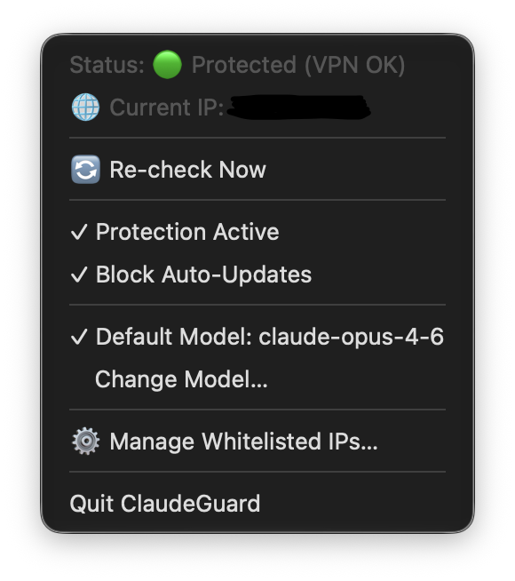
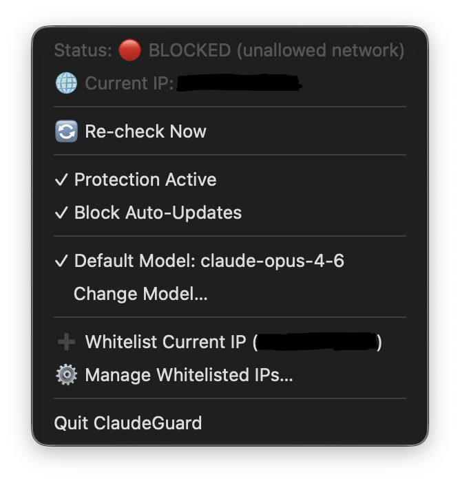
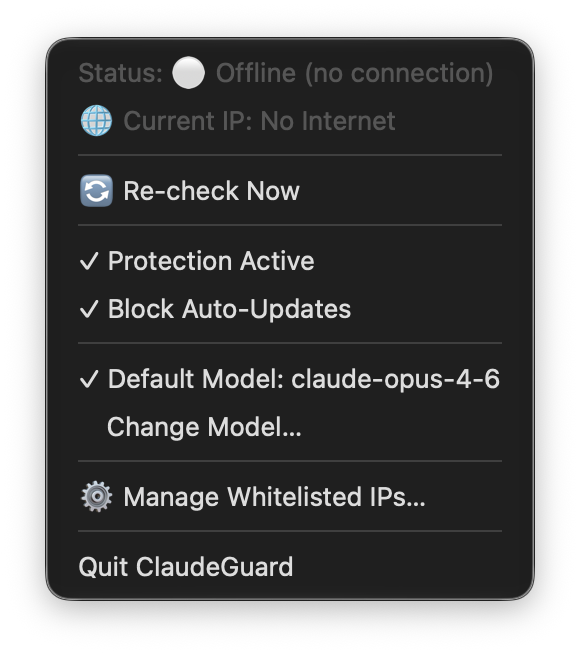
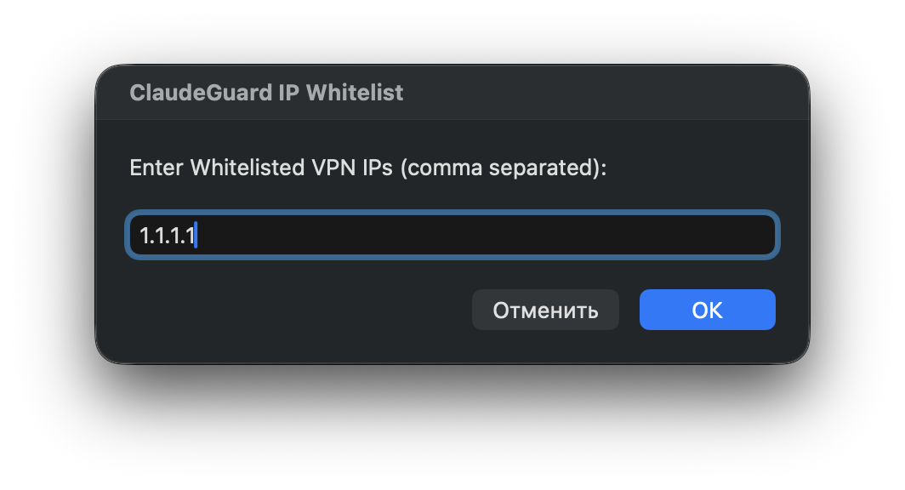
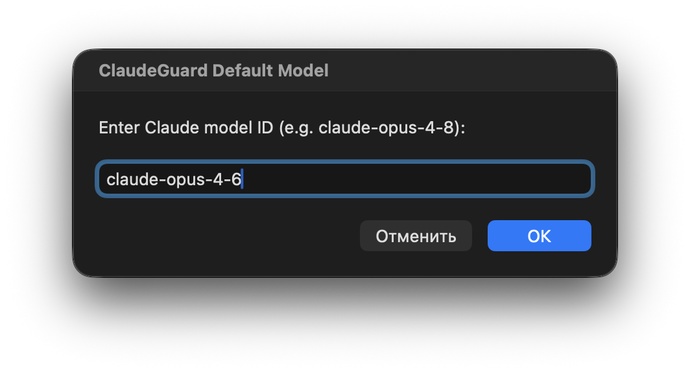

<div align="center">

# 🛡️ ClaudeGuard

**A VPN-whitelist guard for Claude on macOS.**

Blocks the **Claude Desktop** app, the **Claude Code CLI** (`claude`) and every Claude/Anthropic domain (`claude.ai`, `claude.com`, `anthropic.com` and all their subdomains) whenever your public IP is not on your VPN whitelist - so you never touch Claude from the wrong region by accident.

[简体中文](README.zh-CN.md) | **English** | [Русский](README.ru.md)

<br>








</div>

---

## Why

If your account is region-sensitive, a single request from the wrong IP can get your account flagged.
ClaudeGuard solves that: every launch and every running session is checked against your whitelist of allowed IPs, and access is cut the instant you fall off it.

## Features

- 🔐 **IP whitelist** - Claude opens **only** when your public IP matches one of your VPN nodes.
- ⏱ **Instant pre-flight check** - launching `claude` or `Claude.app` verifies the public IP in < 0.5s (STUN over UDP). Not whitelisted → blocked before anything connects.
- 🧠 **One brain, one verdict** - a background daemon publishes the decision to a state file; the CLI, the app launcher and the menu bar all read the same verdict, so nothing can disagree.
- 🚀 **Autostart at login** via `LaunchAgent`.
- 🟢 **Menu bar UI** - live status (🟢 protected / 🔴 blocked / ⚪ offline / 🟡 off), toggles, one-click whitelist.
- ❄️ **Freeze auto-updates** - blocks Claude's update servers and locks the update dirs.
- 🤖 **Default model override** - pin a model for every `claude` session (e.g. `claude-opus-4-8`) from the menu bar; the CLI wrapper injects `--model` automatically so you don't have to type it each time.

## 出口检测模式

基于 [ivblz/ClaudeGuard](https://github.com/ivblz/ClaudeGuard) 的本 fork 增加 `ip_check_mode` 配置，可选择 `both`、`http` 或 `stun`。`both` 要求 HTTP 和 STUN 两个出口均在白名单，判定不再取决于返回先后，旧配置 `auto` 自动迁移为 `both`。使用 HTTP 代理且 UDP 走直连时，选择 `http`，避免 STUN 与 HTTP 返回不同出口造成误拦截。菜单栏的 **出口检测** 子菜单和 `claudeguard set-ip-check-mode http` 均可切换。完整行为与验证方式见 [出口检测配置](docs/ip-check-mode.md)。

## Windows and Linux

A Python port provides a Chinese settings window, guarded launches, process monitoring, and per-user login startup. It does not yet include system-wide firewall enforcement. See [Windows/Linux installation and scope](docs/windows-linux.md).

## Install (macOS)

The installer compiles the native binaries (Swift + C) **on your machine**. Locally-compiled binaries
carry no quarantine flag, so **Gatekeeper never blocks them** - no Apple Developer account, no code-signing,
no notarization, no Homebrew. The only requirement is Xcode Command Line Tools (the installer offers to
install them if missing).

Two ways to install - both give the exact same result.

**Option 1 - one line** (downloads and builds from GitHub):

```bash
bash -c "$(curl -fsSL https://raw.githubusercontent.com/keii-2596/ClaudeGuard/main/install.sh)"
```

**Option 2 - from a local copy** (a cloned or downloaded repo; never touches GitHub):

```bash
./install.sh
```

Either way it compiles for your architecture (Apple Silicon or Intel), installs the menu bar daemon at login,
and wraps the `claude` command. It asks for your password once (`sudo` is needed to edit `/etc/hosts` and pf)
and offers to whitelist your current IP - accept **only if you are on your VPN right now.**

**Uninstall:**

```bash
./uninstall.sh
```

## CLI

After install the `claudeguard` command is available:

| Command | What it does |
|---|---|
| `claudeguard status` | Current status, IP, detection mode and whitelist |
| `claudeguard set-ip-check-mode <both\|http\|stun>` | Select the public-IP detection transport |
| `claudeguard add-ip <ip>` | Add an IP or CIDR to the whitelist |
| `claudeguard remove-ip <ip>` | Remove an IP from the whitelist |
| `claudeguard list-ips` | List whitelisted IPs |
| `claudeguard enable-protection` / `disable-protection` | Turn protection on / off |
| `claudeguard block-updates` / `allow-updates` | Lock / unlock auto-updates |
| `claudeguard set-model <model>` | Set the default model (e.g. `claude-opus-4-8`) |
| `claudeguard enable-model` / `disable-model` | Turn the model override on / off |
| `claudeguard launch-desktop` | Launch Claude Desktop with a pre-flight check |
| `claudeguard start` / `stop` | Start / stop the menu bar daemon |
| `claudeguard doctor` | Check every hook is still attached, and re-attach it |
| `claudeguard set-cli-path <path>` | Point at the real `claude` binary if auto-detect misses it |

### Surviving Claude reinstalls

Reinstalling Claude Code puts the real `claude` binary back over ClaudeGuard's shim,
and updating it deletes the version-stamped path the shim hands off to - so the guard
would silently detach while the menu bar still showed 🟢. The same applies to Claude
Desktop, whose bundle id and update directories have been renamed before.

ClaudeGuard therefore discovers those locations instead of hard-coding them, and
re-attaches whatever came loose: the daemon self-heals **every 60s**, the `claude`
wrapper re-hooks on each run, and `/etc/hosts` is re-applied whenever something
external edits it. Run `claudeguard doctor` to see the state of every hook (and fix
it immediately) at any time.

## How it works

1. **Selectable IP detection** - `http` queries only HTTP services, `stun` queries only UDP STUN. The default `both` checks HTTP and STUN independently and allows access only when both exits are whitelisted, regardless of response order. Legacy `auto` configurations are treated as `both`.
2. **The brain** (`src/brain.py`) turns that IP into one verdict - `allowed` / `blocked` / `offline` - and it **fails closed**: only a confirmed `allowed` lets Claude run.
3. **Single source of truth** - the menu bar daemon writes its verdict to `~/.config/claudeguard/state.json` on every check. The CLI wrapper and app launcher read it (instant), and fall back to their own check if the daemon is down, its state is stale, or its detection mode / whitelist differs from the current configuration.
4. **Enforcement** - the whole Claude/Anthropic domain family (~175 hosts across 5 apex domains) is blocked via `/etc/hosts` + a pf firewall rule (TCP + UDP/QUIC); the desktop app is force-quit with an alert; a running `claude` session is killed the moment the IP leaves the whitelist.

> **Scope:** this is accidental-leak protection for your own machine, not a defense against a malicious admin. The truly unbypassable layer (a Network Extension content filter) requires a paid Apple Developer account; the on-device approach here is the free ceiling and covers accidental leaks well.

## Project structure

```
src/
  brain.py          The single decision core (reads the daemon verdict; STUN fallback)
  ip_checker.py     Public-IP detection: STUN over UDP, then HTTP
  config.py         Config at ~/.config/claudeguard/config.json
  network_guard.py  /etc/hosts + pf firewall block/unblock
  update_guard.py   Freeze/unfreeze Claude auto-updates
  integrity.py      Finds Claude's real paths; re-attaches hooks after a reinstall
  cli_wrapper.py    Pre-flight interceptor for the `claude` command
  app_launcher.py   Pre-flight interceptor for Claude.app
  main.swift        Native menu bar daemon (AppKit): monitoring, alerts, state file
  hosts_helper.c    Root helper run by a LaunchDaemon (no sudoers, no setuid); writes /etc/hosts + pf
bin/claudeguard     Management CLI
assets/AppIcon.png  App icon
install.sh          Compiles natively on-device and installs everything
uninstall.sh        Clean removal, restores the original `claude`
```

## License

MIT - see [LICENSE](LICENSE).
